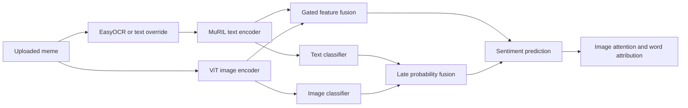

# IndicSent-M

[](https://github.com/dev-maegor/IndicSent-M/actions/workflows/pages.yml)

**Multimodal sentiment analysis for Hinglish and English memes.** IndicSent-M combines text and image signals to classify a meme as **Negative**, **Neutral**, or **Positive**, then exposes model comparisons and input-level explanations in a Gradio interface.

[Project page](https://dev-maegor.github.io/IndicSent-M/) | [GitHub repository](https://github.com/dev-maegor/IndicSent-M) | [Create a Gradio Space](https://huggingface.co/new-space)

> GitHub Pages hosts the static project page. The interactive Python app runs separately on Hugging Face Spaces or locally; Pages cannot run Gradio or Python inference.

## Contents

- [What the app does](#what-the-app-does)
- [How it works](#how-it-works)
- [Results](#results)
- [Run locally](#run-locally)
- [Deploy the Gradio app](#deploy-the-gradio-app)
- [GitHub Pages](#github-pages)
- [Project structure](#project-structure)
- [Data, limitations, and privacy](#data-limitations-and-privacy)

## What the app does

1. Upload a meme image or select one of the supplied examples.
2. Optionally enter or correct the meme text. Leave it blank to extract English-script text with EasyOCR.
3. Choose a fusion strategy. Late fusion also lets you tune the text weight (default `0.55`).
4. Run analysis to see the predicted sentiment, class probabilities, and a comparison of the text, image, late-fusion, and gated multimodal models.
5. Inspect a ViT image-attention overlay and word-level leave-one-out attributions for the selected prediction.

OCR is configured for English characters. It can read Romanized Hinglish but does not transcribe Devanagari Hindi. If OCR misses or misreads text, enter a correction in the optional text field and run the analysis again.

## How it works

The application uses the public pretrained encoders `google/muril-base-cased` and `google/vit-base-patch16-224`, with the trained classification heads and fusion layers stored in this repository.



### Model paths

- **Text model:** MuRIL encodes up to 128 tokens. Attention-mask mean pooling produces a text representation for the three-class classifier.
- **Image model:** ViT-B/16 encodes the image at the processor's expected resolution and classifies the `[CLS]` representation.
- **Late fusion:** blends the text and image probability distributions: `P = alpha * P_text + (1 - alpha) * P_image`. The default `alpha` is `0.55`.
- **Gated fusion:** projects each modality to 256 dimensions, learns a sigmoid gate from both, and classifies their fused features and cross-modal differences.

The app loads all three trained checkpoints because it displays the unimodal and fusion-model comparisons together, regardless of which fusion method is selected for the final result.

### Explanations

- **Image attention:** a ViT patch Grad-CAM overlay; attention rollout is used if gradients are unavailable or uninformative.
- **Text attribution:** leave-one-out scoring masks each word in turn and measures its change to the selected class probability. A positive delta supports that class; a negative delta opposes it.

These visualizations are model signals for inspection. They are not causal explanations.

## Results

Reported scores from [`results/comparison_results.csv`](results/comparison_results.csv):

| Model | Accuracy | Macro F1 | Weighted F1 |
|---|---:|---:|---:|
| Text (MuRIL) | 31.20% | 30.97% | 31.24% |
| Image (ViT) | 33.93% | 30.83% | 30.98% |
| Gated multimodal fusion | **34.53%** | 30.46% | 31.23% |
| Late fusion (`alpha=0.55`) | 33.67% | **32.43%** | **32.78%** |

Gated fusion has the highest accuracy in this comparison. Late fusion has the highest macro and weighted F1. See the **Benchmarks** and **Diagnostics** tabs for the detailed table, confusion matrices, training curves, and XAI examples.

## Run locally

### Requirements

- Python 3.11 is the recommended environment.
- Git and Git LFS are needed to clone the trained checkpoints.
- CPU inference is supported. CUDA is used automatically when PyTorch detects a CUDA-capable device.
- The first run needs internet access to download the pretrained MuRIL and ViT encoders, tokenizer configuration, and EasyOCR model files.
- The three trained checkpoints total about **2.6 GB**. All are stored with Git LFS.

### Windows PowerShell

```powershell
git lfs install
git clone https://github.com/dev-maegor/IndicSent-M.git
cd IndicSent-M

py -3.11 -m venv .venv
.\.venv\Scripts\Activate.ps1
python -m pip install --upgrade pip
python -m pip install -r requirements.txt
python app.py
```

Open the local URL printed by Gradio, normally `http://127.0.0.1:7860`.

If the repository was cloned before Git LFS was installed, run this from the repository directory to fetch the actual checkpoint files:

```powershell
git lfs install
git lfs pull
```

Without Git LFS, the checkpoint paths contain small pointer files instead of model weights and the app will fail to load them.

### macOS or Linux

```bash
git lfs install
git clone https://github.com/dev-maegor/IndicSent-M.git
cd IndicSent-M
python3.11 -m venv .venv
source .venv/bin/activate
python -m pip install --upgrade pip
python -m pip install -r requirements.txt
python app.py
```

For a CUDA setup, install the PyTorch build that matches your CUDA runtime before installing the remaining packages. See the [PyTorch install selector](https://pytorch.org/get-started/locally/).

## Deploy the Gradio app

The repository is ready to sync to a Hugging Face Space. A Space still needs to be created in a Hugging Face account and connected to this repository.

### Automatic GitHub-to-Space sync

A workflow at `.github/workflows/sync-gradio-space.yml` syncs `main` to a Space after you configure two repository settings:

1. Create a **Gradio** Space on Hugging Face and note its ID, in the form `username/space-name`.
2. Create a Hugging Face access token with write access to that Space.
3. In GitHub, open **Settings > Secrets and variables > Actions**. Add:
   - Repository secret `HF_TOKEN`: the Hugging Face write token.
   - Repository variable `HF_SPACE_ID`: the Space ID, for example `username/indic-sent-demo`.
4. Run **Actions > Sync Gradio Space > Run workflow**, or push a later commit to `main`.

The workflow checks out Git LFS contents before syncing, so the Space receives the actual checkpoint files rather than the GitHub LFS pointer text. New pushes to `main` then update and rebuild the Space automatically. Keep the token in GitHub Secrets; never commit it to this repository.

The first sync and build take longer because of the 2.6 GB of checkpoints and pretrained encoder downloads. Choose Space storage and compute that can accommodate the checkpoints and loaded encoders. Available hardware and account requirements can change; check the current [Spaces documentation](https://huggingface.co/docs/hub/spaces-overview) before choosing a plan.

### Space metadata and manual pushes

The sync workflow adds the required Space metadata to the README it sends to Hugging Face, keeping the GitHub README clean. A direct git deployment instead needs a YAML metadata block at the top of the Space README with `sdk: gradio`, `app_file: app.py`, and `python_version: "3.11"`, plus Git LFS or git-xet for the checkpoints. See the official [Spaces configuration guide](https://huggingface.co/docs/hub/spaces-config-reference) before using a direct push. The live Space URL will be `https://huggingface.co/spaces/<username>/<space-name>` after the first successful build. Add that URL to the project page if you want a direct **Launch app** button.

## GitHub Pages

The static landing page is in [`docs/index.html`](docs/index.html). The workflow at `.github/workflows/pages.yml` publishes it after changes to `docs/` are pushed to `main`.

The Pages site is [dev-maegor.github.io/IndicSent-M](https://dev-maegor.github.io/IndicSent-M/). Pages presents the project and links to the source; it cannot host the live Gradio inference service.

## Project structure

```text
.
|-- app.py                         # Gradio UI and inference flow
|-- src/
|   |-- model.py                   # MuRIL, ViT, and fusion classifiers
|   |-- ocr.py                     # EasyOCR preprocessing and cleanup
|   `-- xai.py                     # Image attention and word attribution
|-- artifacts/
|   |-- best_text.pt               # Git LFS checkpoint
|   |-- best_image.pt              # Git LFS checkpoint
|   |-- best_multimodal.pt         # Git LFS checkpoint
|   |-- tokenizer/                 # Tokenizer assets
|   `-- training_config.json       # Training configuration and split sizes
|-- examples/                      # Sample memes used by the UI
|-- results/                       # Metrics, prediction tables, and figures
|-- notebooks/                     # Training and explainability notebooks
|-- docs/index.html                # GitHub Pages project page
`-- .github/workflows/             # Pages deployment and optional Space sync
```

## Data, limitations, and privacy

See [`DATA_CARD.md`](DATA_CARD.md) for the documented Memotion 3.0 splits, label distribution, detailed metrics, and use limitations. The training configuration records a 5,950 / 1,050 train/validation split and a 1,500-example test split. The data card also notes a shift in the Negative-class share between train and test, which can affect class-wise results.

Overall benchmark scores are modest. Meme sentiment is difficult because sarcasm, cultural references, transliteration, OCR quality, and conflicts between image and text all affect the label. Predictions and explanation overlays should be treated as research outputs, not decisions about people.

When running locally, images and text are processed by your local app. When using a hosted Gradio Space, uploaded images and text are sent to that Space for inference; review the host's privacy settings before using sensitive material.
